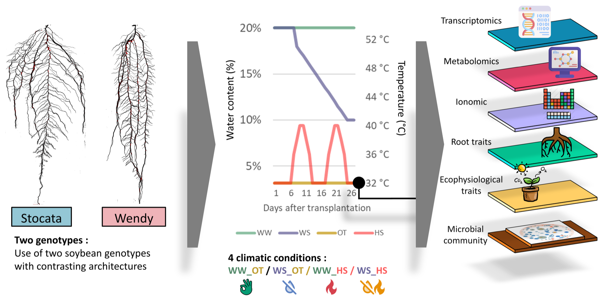

```{r}
#| label: setup
#| include: false
set.seed(2026)   # same jittered points at every render
library(tidyverse)
plants <- read_csv("data/04/soybean_plants.csv", show_col_types = FALSE)
alpha <- read_csv("data/04/soybean_alpha_diversity.csv", show_col_types = FALSE) %>%
  mutate(compartment = factor(compartment, levels = c("Bulk soil", "Rhizosphere",
                                                      "Rhizoplane", "Root endosphere",
                                                      "Phylloplane")))
```

## Overview

::: {.callout-important collapse="true"}
## Clearer wording of the workbook questions (click to open)

Some workbook questions were not worded clearly enough. Below, each one is shown as it
is in your workbook (**before**), then reworded (**after**). They ask exactly the same
thing: keep answering in your own `WORKBOOK.qmd`, under the same question number.

**A1**

*Before:* How many rows and columns does `plants` have? What does one row represent? Many biomass values are `NA`: what does that mean?

*After:*

a) How many rows and how many columns does the table `plants` have?
b) What does one row of the table describe?
c) Many values in the biomass columns are `NA`. What does `NA` mean here?

---

**B1**

*Before:* How many plants had each job? Which job gave the bacteria of the rhizoplane, and which one gave the bacteria of the bulk soil? (See the table in the theory part.)

*After:*

Look at the column `analysis`: it says what each plant was used for.

a) How many plants were used for each type of analysis?
b) The rhizoplane bacteria were sampled on the plants of one type of analysis, and the
bulk soil bacteria on the plants of another. Which ones? (Help: the table "each plant
had one job" in the theory part of the session page.)

---

**B2**

*Before:* Are the watered and drought rhizotubes grouped or mixed? Why would an experimenter mix them on purpose? What do you notice when you compare the two maps?

*After:*

On the map, each coloured square is one rhizotube.

a) Are the drought rhizotubes all together in one area, or mixed with the watered ones?
b) Why would a scientist mix them on purpose?
c) Compare the two maps (heatwave and normal). What do you notice?

---

**B4**

*Before:* How many plants were weighed? Copy the four mean biomasses (2 decimals). Which stress weighs more on the plant, drought or the heatwave?

*After:*

a) How many plants were weighed?
b) Copy the four mean biomasses (2 decimals).
c) Which stress reduces the biomass of the plant more: drought or the heatwave?

---

**B5**

*Before:* How many rows does `organs` have, and why exactly that number? Under drought, which organ keeps the largest share of its biomass (to be sure, compute the mean per organ and water regime, as in B4), and why could that help a plant that is short of water?

*After:*

a) How many rows does the table `organs` have? Why exactly this number?
b) Under drought, which organ (leaf, stem or root) loses the smallest percentage of its
biomass? To be sure, compute the mean biomass per organ and water regime, as in B4.
c) Why could keeping its roots help a plant that does not have enough water?

---

**C1**

*Before:* Which compartments have fewer than 40 samples, and how many samples are missing in total?

*After:*

a) Which compartments have fewer than 40 samples?
b) How many samples are missing in total?

---

**C2**

*Before:* Which compartment has the most diverse bacteria, and which the least? According to the Tukey test, which pairs of compartments do **not** differ? Why could the bacteria inside the root be much less diverse than in the soil around it?

*After:*

a) Which compartment has the most diverse bacteria, and which one the least
diverse?
b) In the Tukey table, which pairs of compartments are **not** significantly different
(`p adj` above 0.05)?
c) Why could the bacteria inside the root be much less diverse than in the soil around
it?

---

**C3**

*Before:* How many rhizoplane samples are there, and how many per combination?

*After:*

a) How many rhizoplane samples are there?
b) How many samples are there in each combination of water, heat and genotype?

---

**C4**

*Before:* Before any statistics: which factor (water, heat or genotype) seems to change Shannon diversity the most? Is it the same factor that weighed most on the plant's biomass (B4)?

*After:*

Look at the plot only, before any statistics.

a) Which factor seems to change the Shannon diversity the most: water, heat or genotype?
b) Is it the same factor that reduced the biomass of the plants the most (B4)?

---

**D1**

*Before:* Mean Shannon diversity (2 decimals) of watered and of drought plants, and the t-test p-value:

*After:*

a) Copy the mean Shannon diversity (2 decimals) of the watered plants and of the
drought plants.
b) Copy the p-value of the t-test.

---

**D2**

*Before:* What is the `estimate` of `waterwatered`, and how does it relate to your two means in D1? Compare its `p.value` with the t-test's.

*After:*

In the table, find the row called `waterwatered` (the column `water`, level
`watered`).

a) What is its `estimate`?
b) Compute the difference between your two means in D1. What do you notice?
c) Is its `p.value` the same as the p-value of the t-test?

---

**D3**

*Before:* Which rows of the ANOVA table have a p-value (`Pr(>F)`) below 0.05? Copy the p-value of `water`.

*After:*

a) Which rows of the ANOVA table have a p-value (column `Pr(>F)`) below 0.05?
b) Copy the p-value of `water`.

---

**D4**

*Before:* What share of the variation (in %) does `water` explain? And the residuals? Was your guess in C4 right?

*After:*

a) What percentage of the variation does `water` explain? And the `Residuals`?
b) Was your guess in C4 correct?

---

**D5**

*Before:* What does the subtitle of your plot say, exactly? Why is it better to compute it in R than to type the number by hand?

*After:*

a) Copy the subtitle of your plot, exactly.
b) Why is it better to compute this p-value with R than to type the number by hand?

---

**E1**

*Before:* How many bulk soil samples are there, and how many per combination?

*After:*

a) How many bulk soil samples are there?
b) How many samples are there in each combination of water, heat and genotype?

---

**E2**

*Before:* Looking only at the plot: which factor moves the means the most, water or heat? Are the two lines roughly parallel, and what would it mean if they were not?

*After:*

Look at the plot only.

a) Which factor changes the mean diversity the most: water (compare left and right on
the x axis) or heat (compare the two lines)?
b) Are the two lines more or less parallel?
c) What would it mean if they were not parallel?

---

**E3**

*Before:* Which factor(s) have a p-value below 0.05 in the bulk soil, and what share of the variation does each explain? Using `bulk_soil_means`, how large is the heatwave effect in Shannon units? Compare it with the drought effect on the rhizoplane (D1).

*After:*

a) Which factor(s) have a p-value below 0.05 in the bulk soil?
b) What percentage of the variation does each of them explain?
c) In `bulk_soil_means`, by how much does the heatwave lower the mean Shannon diversity
(normal minus heatwave)? Compare with the effect of drought on the rhizoplane (D1).

---

**E5 (graded)**

*Before:* Answer today's biological question for the bulk soil, and compare it with the rhizoplane (4-6 sentences). Cite at least one mean, one p-value and one share of variation from your own results. Which factor matters in each compartment, and how much? By what mechanism could drought change the bacteria on the root surface, but not in the soil further from the root? Is the significant effect in the bulk soil also a large one? Refer to your figure with `@fig-bulk`.

*After:*

Answer today's biological question for the bulk soil, and compare it
with the rhizoplane, in 4-6 sentences. Your answer should:

- say which factor matters in the bulk soil and which one on the rhizoplane, and how
  much, with at least one mean, one p-value and one percentage of variation from your
  own results;
- explain how drought could change the bacteria on the root surface, but not in the
  soil further from the root (think of what the root releases and takes up);
- say whether the significant effect in the bulk soil is also a large one;
- refer to your figure with `@fig-bulk`.

---

**E6 (graded)**

*Before:* One limitation, uncertainty or assumption of today's analysis (think, for example, of the number of plants per group, of what the Shannon index does not tell you, or of the y axis of your plot):

*After:*

Give one limitation of today's analysis: something that makes the
conclusion less certain. Ideas: the number of plants per group, what the Shannon index
does not tell you, or the y axis of your plot.


:::

[Download the lecture slides (PDF)](slides/04_lecture_slides.pdf)

::: callout-tip
## Quick poll (Poll Everywhere)

Respond at [pe.app/cmaslard3](https://pe.app/cmaslard3)
:::

::: callout-note
## Biological question

Soybean plants were grown under drought, a heatwave, or both. How much do these stresses
hurt the plants, and do they also change how diverse the bacteria living on and around
their roots are?
:::

Sessions 1-3 were about sequences: reading them, checking them, comparing them. From
today, the course moves to **tables**: one row per sample, one column per measurement.
This is the kind of data you will meet in almost every biology project, whatever the
organism or the technique.

Today's tables are real data from the lab: a soybean experiment where two cultivars grew
under four climates. You will start very gently, with a clean R project and the
**plants** themselves: where they stood in the experiment, what each one was used for,
and how much the stresses weighed on them. You will then turn to the **bacteria** living
on and around them (16S amplicon sequencing), reshape and summarise the tables with
**dplyr** and **tidyr**, draw clearer plots with **ggplot2**, run your first
**statistical tests**, from a t-test to a **linear model** that says which part of the
climate actually matters, and write their results on your plots.

::: callout-important
## How you work and submit today

Everything happens in one file, `WORKBOOK.qmd`: your code, your plots and your answers
together. When you click **Render**, it becomes one HTML page, and that page is what you
submit. You start the workbook in class and submit it on Moodle **by Thursday**.
:::

### Learning outcomes

By the end of this session, you should be able to:

- organise an analysis as a clean R project (`data/`, `results/`, one `.qmd` report) and
  render it;
- describe a table in terms of observations (rows) and variables (columns), and spot
  missing values and missing samples;
- explain the design of the soybean experiment, and why its plants were mixed in space;
- use five dplyr/tidyr verbs (`filter`, `mutate`, `group_by` + `summarise`, `count`,
  `pivot_longer`) to prepare a table for a plot;
- build a ggplot layer by layer: data, aesthetics, geometry, facets, including a map
  with `geom_tile()`;
- choose a test from a simple table (t-test, ANOVA, Tukey, linear model, and their
  alternatives);
- run a t-test, and explain why it is the same thing as a linear model with one factor;
- fit a linear model with several factors, read its ANOVA table, and say how much of the
  variation each factor explains;
- draw an interaction plot (means and error bars) and write a p-value on a plot;
- insert a saved figure into a Quarto report, with a caption and a cross-reference;
- tell apart a *significant* effect and a *large* effect.

### Session plan

| Time | Block | What happens |
|---:|---|---|
| 14:15-14:20 | Retrieval | Session 3 quiz, and who `unknown_sample` really was. |
| 14:20-14:35 | Theory 1 | A clean R project; tidy tables; the grammar of graphics. |
| 14:35-14:50 | Theory 2 | From a boxplot to a linear model; which test, when; the soybean experiment. |
| 14:50-15:00 | Practical briefing | What today's workbook will ask of you. |
| 15:00-15:15 | Practical A | Build the R project, copy the data, render the workbook once. |
| 15:15-15:50 | Practical B | Meet the experiment: the plants, their map, their biomass. |
| 15:50-16:00 | Checkpoint | Map and biomass plots drawn. Short break. |
| 16:00-16:15 | Practical C | The bacteria: first look, then the rhizoplane. (pairs) |
| 16:15-16:35 | Practical D | Guided: the statistics, from a t-test to a linear model, and onto the plot. (pairs) |
| 16:35-16:55 | Practical E | Alone: an interaction plot and its statistics, for the bulk soil. |
| 16:55-17:00 | Wrap-up | Render, save, finish and submit by Thursday. |

## Theory (≈45 min)

### 1. A clean R project

An analysis is not just a result: it is something another person (or you, in six months)
must be able to rerun. The simplest habit that makes this possible is one folder per
analysis, always organised the same way:

```text
session_04/
├── session_04.Rproj      <- double-click to open the project in RStudio
├── WORKBOOK.qmd          <- your report: code + plots + text, in one file
├── data/                 <- raw data: read it, never edit it by hand
│   ├── soybean_plants.csv
│   └── soybean_alpha_diversity.csv
├── img/                  <- images you did not make with R (photos, schemes)
│   └── experimental_design.png
└── results/              <- everything your code produces (figures, tables)
```

Three rules come with it:

- **Raw data is read-only.** You never open the CSV in Excel to "fix" something: every
  change happens in code, so it is visible and repeatable.
- **Paths are relative.** Inside the project, `data/soybean_alpha_diversity.csv` always
  works, on any computer. A path like `C:/Users/me/Desktop/...` only works on yours.
- **The report is the analysis.** A Quarto file (`.qmd`) mixes text and code chunks. When
  you **Render** it, R runs every chunk from top to bottom, in a clean session. If it
  renders, it is reproducible.

### 2. Tidy tables and the grammar of graphics

A **tidy** table has one row per observation (here: one sample) and one column per
variable (compartment, water, heat, shannon, ...). Almost every tool in R expects this
shape.

The **tidyverse** is a family of packages built around tidy tables (each one is
described in the [R toolbox](#your-r-toolbox) below). You will use three of them today:

- **dplyr** manipulates a table: keep some rows (`filter`), add or change a column
  (`mutate`), summarise by group (`group_by` + `summarise`);
- **tidyr** reshapes a table: `pivot_longer` stacks several columns into one;
- **ggplot2** draws it. A ggplot is built in layers, joined with `+`:

```r
ggplot(data, aes(x = ..., y = ..., colour = ...)) +  # which table, which columns where
  geom_boxplot() +                                   # how to draw them
  facet_wrap(~ ...)                                  # one panel per group
```

Steps are chained with the **pipe** `%>%`, read as "and then": take the table, *and then*
keep the rhizoplane, *and then* compute the mean per group. It comes with the tidyverse,
and RStudio types it for you with **Ctrl/Cmd + Shift + M**.

### 3. From a boxplot to a linear model

A boxplot shows that two groups *look* different. A **statistical test** answers whether
that difference is larger than the noise between plants, and a **linear model** also
says how large it is.

The key idea for this course: **most common tests are the same linear model**. A t-test
comparing watered and drought plants is `lm(shannon ~ water)`. Add a second factor and it
becomes a two-way ANOVA: `lm(shannon ~ water * heat)`. The `*` means "each factor, and
their **interaction**": does the effect of drought *depend on* the heatwave?

`anova(model)` then splits the total variation into one piece per factor, plus the
**residuals** (what no factor explains: plant-to-plant noise). Two numbers matter for
each factor:

- the **p-value**: could a difference this large appear by chance alone?
- the **share of variation** it explains (its sum of squares divided by the total): how
  much does it actually matter?

They are not the same thing. With very little noise, a tiny difference can be highly
significant. Always look at both, and at the plot.

**Which test, when?** Keep this table at hand for the rest of the course. Each test
assumes something about the data; when the assumption clearly fails, use the
alternative in the last column.

| Your question | Example with today's data | Test | In R | It assumes | If not |
|---|---|---|---|---|---|
| Do **2 groups** differ? | Shannon, watered vs drought | Student's t-test | `t.test(y ~ group, var.equal = TRUE)` | values roughly normal, similar spread in both groups | Wilcoxon: `wilcox.test(y ~ group)` |
| Do **3 groups or more** differ? (one factor) | Shannon across the 5 compartments | one-way ANOVA | `anova(lm(y ~ group))` | normal residuals, similar spread in all groups | Kruskal-Wallis: `kruskal.test(y ~ group)` |
| **Which** groups differ, after an ANOVA? | which compartments differ from which | Tukey HSD | `TukeyHSD(aov(y ~ group))` | same as the ANOVA | `pairwise.wilcox.test(y, group, p.adjust.method = "BH")` |
| **Several factors** at once, and their interactions? | water × heat × genotype | factorial ANOVA (a linear model) | `anova(lm(y ~ a * b * c))` | same as the ANOVA | transform `y` (for example `log(y)`) and refit |
| Are **two measurements** linked? | leaf biomass vs root biomass | correlation, or regression | `cor.test(x, y)`, `lm(y ~ x)` | a straight-line relationship | Spearman: `cor.test(x, y, method = "spearman")` |

How to check the assumptions of a model: look at its residuals with
`plot(model, which = 1)` (spread) and `plot(model, which = 2)` (normality). Formal tests
exist (`shapiro.test(residuals(model))`), but the plots tell you more.

### 4. Worked example: the soybean experiment

{#fig-design}

- **2 cultivars**, `Stocata` and `Wendy`, chosen for their contrasted root systems;
- **4 climates**: a factorial design of **water** (`watered`, or `drought`: watering
  slowly withdrawn from 20% to 10% soil water content) × **temperature** (`normal`, or
  `heatwave`: two waves at 40 °C for three days);
- plants grew in **rhizotubes**: flat, transparent pots holding **two plants of the same
  condition**, set out in **lines** and **positions** (you will draw this map in block B);
- at the final harvest, **each plant had one job**, because most measurements destroy
  the plant:

| `analysis` in your table | What was done with this plant |
|---|---|
| `physiology` | dry biomass of each organ (leaf, stem, root), photosynthesis, water potential |
| `exudates` | molecules released by the roots, plus dry biomass |
| `omics_and_soil` | gene expression and metabolites of the organs; **its soil** gave the bulk soil and rhizosphere bacteria |
| `plant_microbiome` | the bacteria **on and inside** the plant: rhizoplane, root endosphere, phylloplane |

Two consequences you will meet today:

- the **biomass** and the **bacteria** were measured on **different plants** of the same
  conditions: you can compare conditions, but not link one plant's biomass to its own
  bacteria;
- for the bacteria, each sample was sequenced (16S) and three **alpha-diversity**
  indices computed: `richness` (how many different bacteria), `evenness` (how equally
  they share the space), and `shannon` (combines both; higher = more diverse).

### Practical briefing

Today you work in pairs for blocks A-D, and alone for block E. Block B introduces the
experiment through the **plants**: where they stood, what each one was used for, and
how much the stresses weighed on them. Blocks C and D then turn to the **bacteria** and
walk you through the full analysis on one compartment, the **rhizoplane**: a plot, then
the statistics, then the statistics on the plot. In block E, you analyse the **bulk
soil** on your own, with a different kind of figure: the reasoning is the same, the code
and the answer are not. Your submission is the rendered workbook: your bulk soil figure,
its statistics, and your interpretation are what is graded.

## Your R toolbox

Read this once now, and come back to it whenever a function surprises you. One tab per
package: what it is for, the functions you use today, one example, and the mistake
everyone makes at least once.

::: panel-tabset
## tidyverse

**What it is.** Not one package but a family of packages designed to work together, all
built around tidy tables. `library(tidyverse)` loads the core ones in one line,
including the four below (readr, dplyr, tidyr, ggplot2) and the pipe `%>%`.

**The pipe `%>%`.** Passes what is on its left as the first argument of the function on
its right. These two lines do exactly the same thing:

```r
summarise(group_by(alpha, compartment), mean_shannon = mean(shannon))

alpha %>%
  group_by(compartment) %>%
  summarise(mean_shannon = mean(shannon))
```

The second one reads top to bottom, like a recipe. Shortcut in RStudio:
**Ctrl/Cmd + Shift + M**.

**Common mistake.** Forgetting `library(tidyverse)` after restarting R: every tidyverse
function then fails with `could not find function`. Rendering always starts from a fresh
session, which is why `library()` lives in the first chunk of the workbook.

**Go further.** [R for Data Science](https://r4ds.hadley.nz/) (free online book), and all
the [Posit cheat sheets](https://rstudio.github.io/cheatsheets/).

## readr

**What it is for.** Reading rectangular text files (CSV, TSV) into R as a **tibble**,
the tidyverse version of a table.

| Function | What it does |
|---|---|
| `read_csv("data/file.csv")` | read a comma-separated file |
| `read_tsv("data/file.tsv")` | read a tab-separated file |
| `write_csv(table, "results/file.csv")` | save a table you computed |

**What to check.** `read_csv()` guesses each column's type and tells you what it found:
`chr` (text) or `dbl` (number). Always glance at that message, or at `glimpse()`: a
column of numbers read as `chr` means something in the file is not a number (a comma
decimal, a "NA" typed as "n/a", a unit in a cell...).

**Common mistake.** A path that only works on your computer
(`"C:/Users/me/Desktop/data.csv"`). Inside an R project, always write the path from the
project folder: `"data/soybean_alpha_diversity.csv"`.

**Cheat sheet.** [Data import with readr](https://rstudio.github.io/cheatsheets/html/data-import.html)

## dplyr

**What it is for.** Manipulating a table: choosing rows, creating columns, summarising
groups. Each function is a verb, takes a table first, and returns a new table.

| Verb | What it does | Today |
|---|---|---|
| `filter()` | keep the rows that match a condition | `filter(compartment == "Rhizoplane")` |
| `mutate()` | add a column or change one | `mutate(compartment = factor(...))` |
| `count()` | count rows per group | `count(alpha, compartment)` |
| `group_by()` + `summarise()` | one summary row per group | `group_by(water) %>% summarise(mean = mean(shannon))` |
| `is.na()` | `TRUE` where a value is missing; `!is.na()` keeps what is there | `filter(!is.na(biomass_total))` |
| `pull()` | take one column out of a table, as a plain value | `filter(term == "heat") %>% pull(p.value)` |
| `select()`, `arrange()` | keep some columns; sort rows | not needed today, good to know |

**Example.** Mean Shannon diversity per compartment and water regime, sorted:

```r
alpha %>%
  group_by(compartment, water) %>%
  summarise(mean_shannon = mean(shannon)) %>%
  arrange(mean_shannon)
```

With two grouping columns, `summarise()` prints a message about "grouped output": it is
information, not an error.

**Common mistakes.**

- `=` instead of `==` in `filter()`. `=` gives a value to an argument, `==` tests
  equality. dplyr spots it and suggests the fix.
- Forgetting the quotes: `filter(compartment == Rhizoplane)` looks for a *column*
  called `Rhizoplane`. Values of text columns always go in quotes, column names never.
- A `mutate()` that is not saved: `alpha %>% mutate(...)` only *shows* the result. To
  keep it, assign it: `alpha <- alpha %>% mutate(...)`.

**Cheat sheet.** [Data transformation with dplyr](https://rstudio.github.io/cheatsheets/html/data-transformation.html)

## tidyr

**What it is for.** Changing the *shape* of a table without changing its content.

- **Wide**: one row per plant, one column per measurement (`biomass_leaf`,
  `biomass_stem`, `biomass_root`). Easy to read for a human, and the shape of `plants`.
- **Long**: one row per plant *and* organ, with a column saying which organ it is
  (`organ`) and one with its value (`biomass`). The shape ggplot needs to put the organs
  side by side, or in their own panels.

| Function | What it does |
|---|---|
| `pivot_longer(cols, names_to, values_to)` | wide → long: stack several columns into two |
| `pivot_longer(..., names_prefix = "biomass_")` | the same, removing the start of the old column names |
| `pivot_wider(names_from, values_from)` | long → wide: the exact reverse |

```r
organs <- physio %>%
  pivot_longer(cols = c(biomass_leaf, biomass_stem, biomass_root),
               names_to = "organ", names_prefix = "biomass_",
               values_to = "biomass")

organs %>%
  pivot_wider(names_from = organ, values_from = biomass)   # back to one row per plant
```

The same works for the three diversity indices of `alpha` (`richness`, `shannon`,
`evenness`).

**How to think about it.** Ask "what should one row be?". For one box per organ, one
row must be one organ of one plant, so: long.

**Common mistake.** Forgetting the quotes in `names_to = "organ"`: the new column does
not exist yet, so its name is text.

**Cheat sheet.** [Data tidying with tidyr](https://rstudio.github.io/cheatsheets/html/tidyr.html)

## ggplot2

**What it is for.** Plots, built layer by layer. Every ggplot has the same three parts:

1. **data**: which table (`ggplot(alpha, ...)`);
2. **aesthetics**, inside `aes()`: which column goes where (`x`, `y`, `colour`, `fill`);
3. **geometries**, `geom_...()`: how to draw it (boxes, points, bars).

Then optional layers: `facet_wrap()` (one panel per group), `labs()` (titles and axis
names), `theme_bw()` and friends (overall look).

| Layer | Today |
|---|---|
| `geom_boxplot()` | distribution per group |
| `geom_jitter()`, `geom_point()` | one point per sample |
| `geom_tile()` | one rectangle per row, placed by `x` and `y` (a map) |
| `geom_col()` | bars whose height is a value (the share of variation) |
| `geom_line()` | lines joining points of the same `group` (interaction plot) |
| `geom_errorbar(aes(ymin = ..., ymax = ...))` | error bars around a mean |
| `facet_wrap(~ genotype)` | one panel per cultivar |
| `labs(x = ..., y = ..., subtitle = ...)` | readable axis names, and a subtitle for your statistics |
| `theme_bw()` | a clean white background |
| `ggsave("results/plot.png")` | save the last plot |

**Example.** The B3 plot, with readable labels and a cleaner theme:

```r
ggplot(alpha, aes(x = compartment, y = shannon)) +
  geom_boxplot(outlier.shape = NA) +
  geom_jitter(aes(colour = water), width = 0.2) +
  labs(x = NULL, y = "Shannon diversity", colour = "Water regime") +
  theme_bw()
```

**Common mistakes.**

- `%>%` between layers instead of `+`. The pipe passes data; `+` adds layers. ggplot2
  even asks "Did you use `%>%` instead of `+`?".
- A fixed colour inside `aes()`: `aes(colour = "red")` does **not** make points red, it
  creates a fake group called "red" (drawn in the default pink, with a legend). A fixed
  colour goes *outside*: `geom_point(colour = "red")`. Rule: inside `aes()` = a column,
  outside = a fixed value.

**Cheat sheet.** [Data visualization with ggplot2](https://rstudio.github.io/cheatsheets/html/data-visualization.html)

## broom

**What it is for.** Turning the output of a statistical model into a normal tibble, so
you can filter it, compute with it, or plot it with ggplot, like any other table.

| Function | What it returns |
|---|---|
| `tidy(model)` | one row per term: estimate, p-value... |
| `tidy(anova(model))` | the ANOVA table as a tibble (`sumsq`, `p.value`...) |
| `glance(model)` | one row for the whole model: R², number of observations... |

**Example: a t-test is a linear model.** On the rhizoplane, with water as the only
factor:

```r
library(broom)
tidy(lm(shannon ~ water, data = rhizoplane))
```

The `(Intercept)` row is the mean Shannon diversity of the drought plants (the
reference group, first in alphabetical order); the `waterwatered` row is how much
higher the watered plants are, with its p-value. That is exactly what a t-test reports.

**Common mistake.** broom is installed with the tidyverse but **not loaded** by
`library(tidyverse)`: you need `library(broom)` once.

**Documentation.** [broom.tidymodels.org](https://broom.tidymodels.org/)
:::

## Practical (≈1 h 50)

### New R functions for today

This is the first R-heavy session, so the usual limit of four new functions does not
hold: think of it as five ideas (read, reshape, plot, summarise, model), each with a few
words of vocabulary.

| Idea | Functions | Example |
|---|---|---|
| Read and look | `library`, `read_csv`, `glimpse` | `alpha <- read_csv("data/soybean_alpha_diversity.csv")` |
| Manipulate (dplyr) | `filter`, `is.na`, `mutate`, `count`, `group_by` + `summarise` | `alpha %>% filter(compartment == "Rhizoplane")` |
| Reshape (tidyr) | `pivot_longer` | `pivot_longer(cols = c(biomass_leaf, biomass_root), names_to = "organ")` |
| Plot (ggplot2) | `ggplot`, `aes`, `geom_tile`, `geom_boxplot`, `geom_jitter`, `geom_point`, `geom_line`, `geom_errorbar`, `facet_wrap`, `labs`, `ggsave` | `ggplot(alpha, aes(x = compartment, y = shannon)) + geom_boxplot()` |
| Test and model | `t.test`, `TukeyHSD`, `aov`, `lm`, `anova`, `tidy`, `pull` | `anova(lm(shannon ~ water * heat, data = rhizoplane))` |

::: callout-tip
## Tested on LEGcompute

RStudio Server's R (4.6.1) already has the **tidyverse**, **broom**, **rmarkdown**, and
**knitr** installed, and RStudio Server ships its own Quarto: nothing to install, no
`module load` needed today.
:::

### A. Build the R project, render once (15:00-15:15)

Open RStudio Server, then the **Terminal** tab (next to Console). You know these commands
from Sessions 1-3:

```bash
mkdir -p ~/bioinfo_course/session_04/data ~/bioinfo_course/session_04/img ~/bioinfo_course/session_04/results
cp /home/cmaslard/bioinfo_tools_course/session_04/soybean_plants.csv ~/bioinfo_course/session_04/data/
cp /home/cmaslard/bioinfo_tools_course/session_04/soybean_alpha_diversity.csv ~/bioinfo_course/session_04/data/
cp /home/cmaslard/bioinfo_tools_course/session_04/experimental_design.png ~/bioinfo_course/session_04/img/
cp /home/cmaslard/bioinfo_tools_course/session_04/WORKBOOK.qmd ~/bioinfo_course/session_04/
ls -R ~/bioinfo_course/session_04
```

Now turn the folder into an R project: **File → New Project → Existing Directory →
Browse**, pick `~/bioinfo_course/session_04`, then **Create Project**. RStudio restarts
inside the project: the Files pane now shows `session_04.Rproj`, `WORKBOOK.qmd`, `data/`,
`img/` and `results/`.

Open `WORKBOOK.qmd`, write your name at the top, and click **Render** (the blue arrow
above the editor).

::: callout-note
## Checkpoint

`WORKBOOK.html` appears next to `WORKBOOK.qmd` and opens in a new tab or the Viewer. It
shows a few error messages from section B4 on: that is expected, those chunks still
contain `___` blanks. Section A must show the `glimpse()` output without error.
:::

::: callout-tip
## "Error: unexpected input"?

That is what R says when it meets a `___` you have not filled in yet. RStudio also marks
the line with a red cross in the margin. Replace the `___` and run the chunk again.
:::

From now on, run chunks one by one with the green ▶ button at the top right of each chunk
(or Ctrl/Cmd + Enter for one line), and render again whenever you want to check the full
report.

The first chunk of the workbook loads the packages and reads the plant table:

```r
library(tidyverse)   # readr, dplyr, tidyr, ggplot2 and the pipe
library(broom)       # turns statistical results into tables (used from D2 on)
plants <- read_csv("data/soybean_plants.csv")
glimpse(plants)
```

All `library()` calls go at the very top of a report: anyone reading it sees at once
what it needs, and a later chunk that fails cannot take a package down with it.

`glimpse()` lists every column with its type: `<chr>` is text, `<dbl>` is a number. `NA`
means "not available": nothing was measured there.

Just below that chunk, the workbook shows the design of the experiment as Figure 1.
It is not made by R: it is an image file, inserted with one line of text.

::: callout-tip
## Insert an image into a Quarto report

One line, **outside** any code chunk:

```markdown
{#fig-design width=100%}
```

- `![...]`: the caption, printed under the image as "Figure 1: ...";
- `(...)`: the path to the file, from the project folder, like `read_csv()`;
- `{#fig-design width=100%}`: a label, which must start with `fig-`, and options such
  as the width;
- anywhere in your text, `@fig-design` becomes "Figure 1", a link to the figure. Add a
  figure above it, and the numbers update themselves.

The rendered HTML still stays **one single file**: the image is packed inside it. You
will do it yourself in block E, with the figure you save.
:::

::: callout-note
## Checkpoint

`Rows: 240`, `Columns: 12`. One row per plant of the final harvest: its `rhizotube`, its
place (`line`, `position`), its condition (`genotype`, `water`, `heat`), its job
(`analysis`) and, for some plants only, its dry biomass in grams (`biomass_leaf`,
`biomass_stem`, `biomass_root`, `biomass_total`).
:::

### B. Meet the experiment: the plants (15:15-15:50)

Before looking at any bacteria, understand the experiment they come from, and check that
the stresses really hurt the plants.

**B1. Who did what?** Count the plants per job, then per condition:

```r
count(plants, analysis)
count(plants, heat, water, genotype)
```

::: callout-note
## Checkpoint

Four jobs: 66 `physiology`, 53 `exudates`, 75 `omics_and_soil`, 46 `plant_microbiome`.
Eight conditions, 26 to 34 plants each: the design is not perfectly balanced, because
some plants died or were replaced during the experiment.
:::

**B2. The map of the experiment.** Each rhizotube had a `line` and a `position`. Draw
them as a map: one tile per rhizotube, coloured by water regime, with a symbol for the
cultivar, and one map per heat regime:

```r
ggplot(plants, aes(x = position, y = line)) +
  geom_tile(aes(fill = water), colour = "white") +
  geom_point(aes(shape = genotype)) +
  facet_wrap(~ heat, ncol = 1)
```

`geom_tile()` draws one rectangle per row of the table (the two plants of a rhizotube
fall on the same tile); `fill` colours the inside of a shape, `shape` changes the symbol
of a point.

```{r}
#| label: fig-b2
#| echo: false
#| fig-width: 8
#| fig-height: 5
#| fig-cap: "Checkpoint B2: the map of the experiment, one tile per rhizotube."
ggplot(plants, aes(x = position, y = line)) +
  geom_tile(aes(fill = water), colour = "white") +
  geom_point(aes(shape = genotype)) +
  facet_wrap(~ heat, ncol = 1)
```

Look at it before you go on. Are the watered and drought rhizotubes grouped together,
or mixed? Why would an experimenter mix them on purpose? Compare the two maps. The empty
cells held plants harvested earlier, for another part of the experiment.

**B3. Did the stresses hurt the plants?** Only the `physiology` and `exudates` plants
were weighed: for the others, the biomass columns are `NA`. Keep the plants that have a
biomass, then plot it:

```r
physio <- plants %>%
  filter(!is.na(biomass_total))

ggplot(physio, aes(x = water, y = biomass_total, colour = heat)) +
  geom_boxplot(outlier.shape = NA) +
  geom_point(position = position_jitterdodge(jitter.width = 0.1)) +
  facet_wrap(~ genotype)
```

`is.na(biomass_total)` is `TRUE` when the biomass is missing; the `!` in front means
"not". So `filter(!is.na(biomass_total))` keeps the plants that **were** weighed.

**B4. The same thing as numbers.**

```r
physio %>%
  group_by(water, heat) %>%
  summarise(n = n(), mean_biomass = mean(biomass_total))
```

::: callout-note
## Checkpoint

`physio` has 108 plants. Mean dry biomass: about 1.25 g (watered, normal), 1.16 g
(watered, heatwave), 0.50 g (drought, normal), 0.32 g (drought, heatwave). Drought
divides the plant's biomass by more than two; the heatwave takes a little more on top.
:::

**B5. Which organ suffers most? (tidyr)** The biomass of each organ sits in its own
column. To draw the three organs side by side, ggplot needs them **stacked** in one
column, with a second column saying which organ each value belongs to. That is what
`pivot_longer` does:

```r
organs <- physio %>%
  pivot_longer(cols = c(biomass_leaf, biomass_stem, biomass_root),
               names_to = "organ",
               names_prefix = "biomass_",
               values_to = "biomass")

ggplot(organs, aes(x = organ, y = biomass, fill = water)) +
  geom_boxplot() +
  facet_wrap(~ heat)
```

`names_prefix = "biomass_"` removes the start of the column names, so the organs are
simply called `leaf`, `stem` and `root`. `organs` has three times more rows than
`physio`: one per plant *and* organ.

::: callout-note
## Checkpoint

`organs` has 324 rows (108 × 3). Under drought, every organ loses roughly two thirds of
its biomass, but not exactly the same share: compare the root with the leaf.
:::

### 15:50-16:00: Checkpoint and short break

Before the break: the map and the biomass plots drawn, and the B questions of the
workbook answered. Click **Render** once to check that sections A and B now render
without red errors.

### C. The bacteria: first look, then the rhizoplane (16:00-16:15, pairs)

The plants are clearly stressed. Do their bacteria feel it?

**C1. A second table.** Read the bacterial diversity table and count the samples per
compartment:

```r
alpha <- read_csv("data/soybean_alpha_diversity.csv")
count(alpha, compartment)
```

::: callout-note
## Checkpoint

195 samples. Each compartment was sampled on 40 plants (5 per condition), but some
compartments have fewer than 40 samples: a few failed (too little DNA, too few reads)
and were removed before you got the table.
:::

**C2. Diversity from the soil to the leaf.** The compartments come out in
**alphabetical** order by default, which makes no biological sense. Fix the order with
`mutate()`, then plot every sample:

```r
alpha <- alpha %>%
  mutate(compartment = factor(compartment,
                              levels = c("Bulk soil", "Rhizosphere", "Rhizoplane",
                                         "Root endosphere", "Phylloplane")))

ggplot(alpha, aes(x = compartment, y = shannon)) +
  geom_boxplot(outlier.shape = NA) +
  geom_jitter(aes(colour = water), width = 0.2)
```

```{r}
#| label: fig-c2
#| echo: false
#| fig-width: 8
#| fig-height: 4
#| fig-cap: "Checkpoint C2: Shannon diversity per compartment, one point per sample."
ggplot(alpha, aes(x = compartment, y = shannon)) +
  geom_boxplot(outlier.shape = NA) +
  geom_jitter(aes(colour = water), width = 0.2)
```

Which compartments differ from which? With five groups, that is a job for an ANOVA
followed by a **Tukey test** (see the table in the theory part), in one line:

```r
TukeyHSD(aov(shannon ~ compartment, data = alpha))
```

One row per pair of compartments: `diff` is the difference of their means, `p adj` its
p-value, corrected for the fact that you test ten pairs at once.

::: callout-note
## Checkpoint

Bulk soil vs rhizosphere: `p adj` close to 1 (no difference). Rhizoplane vs phylloplane:
0.12. Every other pair: below 0.01. The spread is very different between compartments
(look at the plot), which an ANOVA does not like: the table's alternative,
`kruskal.test(shannon ~ compartment, data = alpha)`, reaches the same conclusion.
:::

**C3. Keep one compartment.** Comparing climates across compartments would mix two very
different questions. Work on one compartment at a time, starting with the rhizoplane:

```r
rhizoplane <- alpha %>%
  filter(compartment == "Rhizoplane")

count(rhizoplane, water, heat, genotype)
```

::: callout-note
## Checkpoint

39 samples, 8 combinations of water × heat × genotype, 4 or 5 samples each.
:::

**C4. Plot the design.** The same kind of plot as for the biomass in B3:

```r
ggplot(rhizoplane, aes(x = water, y = shannon, colour = heat)) +
  geom_boxplot(outlier.shape = NA) +
  geom_point(position = position_jitterdodge(jitter.width = 0.1)) +
  facet_wrap(~ genotype)
```

```{r}
#| label: fig-c4
#| echo: false
#| fig-width: 8
#| fig-height: 4
#| fig-cap: "Checkpoint C4: rhizoplane Shannon diversity by water, heat and cultivar."
rhizoplane <- alpha %>% filter(compartment == "Rhizoplane")
ggplot(rhizoplane, aes(x = water, y = shannon, colour = heat)) +
  geom_boxplot(outlier.shape = NA) +
  geom_point(position = position_jitterdodge(jitter.width = 0.1)) +
  facet_wrap(~ genotype)
```

Before any statistics: which of the three factors seems to change Shannon diversity the
most? Is it the same factor that weighed most on the plant's biomass in B3? Write your
guess in the workbook.

### D. Guided: the statistics (16:15-16:35, pairs)

**D1. Two groups: a t-test.** Start with the simplest question: do watered and drought
plants differ?

```r
rhizoplane %>%
  group_by(water) %>%
  summarise(n = n(), mean_shannon = mean(shannon))

t.test(shannon ~ water, data = rhizoplane, var.equal = TRUE)
```

Read `~` as "explained by": Shannon explained by water. `var.equal = TRUE` asks for the
classic t-test, the one that assumes both groups vary as much.

::: callout-note
## Checkpoint

Means of 2.40 (drought) and 3.24 (watered); the t-test gives `p-value = 2.601e-06`.
:::

**D2. The same test, as a linear model.** Now fit `lm()` with the same formula, and read
it with `tidy()` from the broom package (loaded in section A):

```r
tidy(lm(shannon ~ water, data = rhizoplane))
```

Two rows. `(Intercept)` is the mean of the drought plants (the reference group: first in
alphabetical order). `waterwatered` is how much higher the watered plants are, and its
`p.value` is **exactly the t-test's p-value**. A t-test *is* a linear model with one
factor: this is why the next step can simply add more factors.

**D3. All three factors at once.** One line fits water, heat, genotype and all their
interactions; one more line splits the variation:

```r
model_rhizoplane <- lm(shannon ~ water * heat * genotype, data = rhizoplane)
anova(model_rhizoplane)
```

Read the table row by row: one row per factor or interaction, `Residuals` last. The
column `Pr(>F)` is the p-value; R adds stars to the small ones.

::: callout-note
## Checkpoint

Only one row has three stars: `water`, with `Pr(>F)` = 4.01e-06. `heat` is close
(0.06) but above 0.05. No interaction is significant.
:::

**D4. How much does each factor explain?** The p-value says *whether*; the share of
variation says *how much*. `tidy()` also turns the ANOVA table into a normal tibble, so
you can compute with it:

```r
anova_rhizoplane <- tidy(anova(model_rhizoplane)) %>%
  mutate(share = sumsq / sum(sumsq))
anova_rhizoplane

ggplot(anova_rhizoplane, aes(x = "Rhizoplane", y = share, fill = term)) +
  geom_col() +
  labs(x = NULL, y = "Share of variation in Shannon diversity")
```

One bar, cut into slices: the bigger the slice, the more that factor explains. The
`Residuals` slice is everything the design does not explain.

::: callout-note
## Checkpoint

`water` explains about 45% of the variation, the residuals about 45%, and everything else
together about 10%.
:::

**D5. Put the statistics on the plot.** A figure should carry its own evidence. Keep the
p-value in an object, then write it in the plot's subtitle with `paste()`, which glues
pieces of text together:

```r
p_water <- t.test(shannon ~ water, data = rhizoplane, var.equal = TRUE)$p.value
p_water

ggplot(rhizoplane, aes(x = water, y = shannon)) +
  geom_boxplot(outlier.shape = NA) +
  geom_jitter(width = 0.1) +
  labs(title = "Rhizoplane",
       subtitle = paste("t-test, drought vs watered: p =", signif(p_water, 2)),
       x = NULL, y = "Shannon diversity") +
  theme_bw()
```

`$p.value` takes one element out of the test result. `signif(p_water, 2)` keeps two
significant digits, so the subtitle reads `p = 2.6e-06` instead of fifteen digits.

```{r}
#| label: fig-d5
#| echo: false
#| fig-width: 5
#| fig-height: 4
#| fig-cap: "Checkpoint D5: the t-test p-value written on the plot."
p_water <- t.test(shannon ~ water, data = rhizoplane, var.equal = TRUE)$p.value
ggplot(rhizoplane, aes(x = water, y = shannon)) +
  geom_boxplot(outlier.shape = NA) +
  geom_jitter(width = 0.1) +
  labs(title = "Rhizoplane",
       subtitle = paste("t-test, drought vs watered: p =", signif(p_water, 2)),
       x = NULL, y = "Shannon diversity") +
  theme_bw()
```

### E. Alone: the bulk soil (16:35-16:55)

Now the **bulk soil**, the soil in the pot that does not touch the root. This time you
do not redraw the same boxplot: you build a different kind of figure, an **interaction
plot**, and put the statistics on it. Section E of the workbook guides you with a
skeleton and a few `___` to fill.

**What an interaction plot shows.** One point per group **mean**, with an **error bar**
(here the standard error: how precisely the mean is known), and a **line** joining the
means of the same heat regime across the two water regimes. How to read it:

- a line that goes up or down: the water regime changes Shannon diversity;
- two lines far apart: the heat regime changes Shannon diversity;
- two lines that are **not parallel**: an **interaction**, the effect of drought depends
  on the heatwave.

You need three new geometries, all in the [ggplot2 tab](#your-r-toolbox) of the toolbox:
`geom_point()` for the means, `geom_line()` to join them (with `group = heat` in `aes()`,
so ggplot knows which points to join), and `geom_errorbar()` for the bars. The means and
standard errors come from a `group_by()` + `summarise()`, as in B4.

Then, in the workbook:

- **E1.** Keep the bulk soil samples and count them (adapt C3).
- **E2.** Compute the means and standard errors, and draw the interaction plot.
- **E3.** Fit the three-factor model and compute the share of variation (adapt D3-D4).
- **E4.** Write the ANOVA p-values of heat and water on your plot (adapt D5), give it
  readable labels, and save it with `ggsave()`:

```r
ggsave("results/bulk_soil_interaction.png", width = 6, height = 4)
```

`ggsave()` saves the **last plot drawn** into `results/`. Then **insert that file into
your report** yourself, below the chunk, as in the callout of block A: a caption of
your own that says what the figure shows, the label `#fig-bulk`, a width of `80%`. Cite
it as `@fig-bulk` in your answer to E5. Then answer the E questions:
they are the graded part of today. Compare with the rhizoplane: is the answer the same?
Is the most significant effect also a *large* one, in Shannon units? Look at the y axis
of your plot before you answer.

### Wrap-up (16:55-17:00)

Click **Render** one last time. Check that `WORKBOOK.html` shows your bulk soil figure and
your ANOVA table, and that `results/bulk_soil_interaction.png` exists. You can finish the
written answers at home: submit `WORKBOOK.html` on Moodle **by Thursday**.

If your workbook refuses to render at the end, do not panic: submit `WORKBOOK.qmd`
instead, and say in the last section where it fails.

::: callout-note
## How this is graded (10 points)

| Criterion | Points | What it looks for |
|---|---:|---|
| Reproducible workflow | 2 | The workbook renders (or the code is complete and in order), inside a clean project. |
| Working analysis | 3 | Sections A-E ran and the checkpoint numbers you copied are right. |
| Required result | 2 | The bulk soil interaction plot (section E): means, error bars, readable labels, the p-values written on it, saved and inserted into the report with a caption. |
| Biological interpretation | 2 | Your answer to E5, citing your own numbers and comparing the bulk soil with the rhizoplane. |
| Reflection | 1 | Your limitation sentence in E6. |
:::

## Checkpoint

You are done when all of the following are true:

- your `session_04` folder is an R project with `data/`, `results/` and a workbook that
  renders;
- you can explain the design of the experiment from your map: the conditions, why they
  are mixed in space, and why each plant had one job;
- you can say how much drought and the heatwave reduced the plants' biomass, and which
  organ suffered most;
- you can say what a row and a column of `alpha` represent, and why some compartments
  have fewer than 40 samples;
- you used `filter`, `mutate`, `count`, `group_by` + `summarise` and `pivot_longer`, and
  can say in one sentence what each one did;
- you built a ggplot with boxes, points, colours and facets, a map with `geom_tile()`,
  and an interaction plot with means, lines and error bars;
- you used a Tukey test to find which compartments differ, and know which test to pick
  for a new question from the table;
- you ran a t-test and found the same p-value with `lm()`;
- you fitted `lm(shannon ~ water * heat * genotype)` on two compartments and can say,
  for each, which factor matters and how much of the variation it explains;
- you wrote a p-value on a plot from a value computed in R, not typed by hand;
- you inserted a saved figure into your report, with a caption, and cited it with
  `@fig-bulk`;
- you can explain why a significant effect is not necessarily a large one.

## Optional challenge

For your own interest, not graded.

**A. All five compartments in one figure.** Repeat D3-D4 for the rhizosphere, the root
endosphere and the phylloplane, add a `compartment` column to each `anova_...` table with
`mutate()`, stack them with `bind_rows()`, and draw one bar per compartment with
`geom_col()`. Is there a pattern from soil to leaf?

**B. Check the model's assumptions.** A linear model assumes the residuals are roughly
normal and equally spread across groups. `plot(model_rhizoplane, which = 1)` and
`plot(model_rhizoplane, which = 2)` draw the two classic diagnostic plots. Do the
rhizoplane residuals look acceptable?

**C. The plant is not independent.** The rhizoplane and the root endosphere come from
the *same* plants (look at the `plant` column). Fitting one model on both compartments at
once, with the plant as a random effect, is what a mixed model does:
`lme4::lmer(shannon ~ compartment * water + (1 | plant), data = ...)`. What changes
compared to two separate models?

**D. Does the place in the experiment matter?** Colour the map by biomass instead of
water regime, with one panel per climate so that the drought effect does not hide
everything else:

```r
ggplot(physio, aes(x = position, y = line, fill = biomass_total)) +
  geom_tile() +
  facet_grid(heat ~ water)
```

Do the plants at one end of the lines, or on one line, look bigger? Then test it: add
`+ line + position` at the end of a model of `biomass_total`. Why does the mixing you saw
in B2 protect the conclusions even if position has a small effect?

**E. Two stresses together.** Fit `lm(biomass_total ~ water * heat * genotype, data =
physio)`, look at its ANOVA table, then fit the same model on `log(biomass_total)`. The
interaction `water:heat` changes a lot. Compute, from B4, by how many percent the
heatwave reduces the biomass of watered plants, and of drought plants. What does the
log scale see that the raw scale missed, and what does it mean for a plant facing both
stresses at once?

## Going further

Free, well-written references if you want more statistics than one session can hold:

- [Common statistical tests are linear models](https://lindeloev.github.io/tests-as-linear/)
  (J. K. Lindeløv): t-test, ANOVA, correlation... all as `lm()`, with R code.
- [Points of Significance](https://blogs.nature.com/blog/points-of-significance-is-now-free-access/)
  (Nature Methods, free access): two-page articles for biologists, in particular *Two-factor designs*.
- [Data Carpentry: R for Ecologists](https://lessons.datacarpentry.org/R-ecology-lesson/):
  a complete beginner course on R, dplyr and ggplot2.
- [Introduction to Statistics with R](https://sib-swiss.github.io/Introduction-to-statistics-with-R/)
  (SIB Swiss Institute of Bioinformatics).

## Before the next session

Session 5 moves from **one** variable (Shannon diversity) to **hundreds at once**: a
metabolomics table, where every column is a molecule. You will keep the same R project
habits, the same dplyr verbs and ggplot layers, and meet two new kinds of plots to see
the whole table in one picture.
